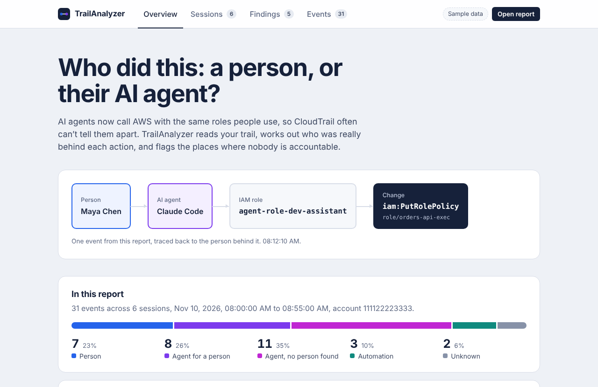
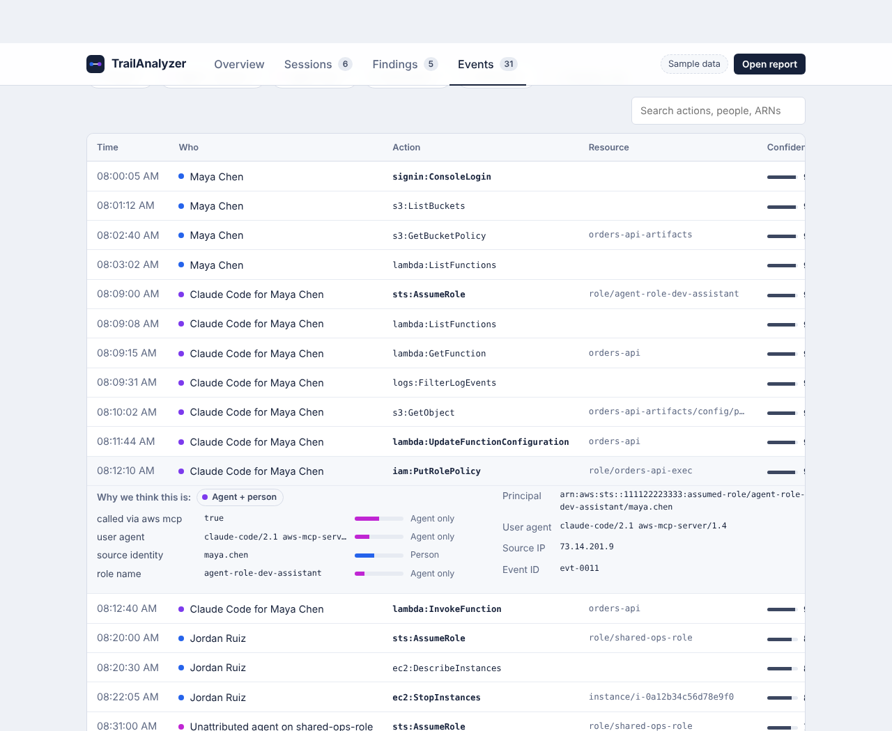

# TrailAnalyzer

**Who did this: a person, or their AI agent?**

AI agents now call AWS with the same IAM roles people use. When an agent and a person share a role, CloudTrail records the same principal for both, and the audit trail can no longer say who is accountable for an action.

TrailAnalyzer reads AWS CloudTrail and works out who was really behind each API call:

| Actor type | Meaning |
| --- | --- |
| Person | A person acting directly, in the console or the CLI |
| Agent for a person | An AI agent, and we can tell which person it worked for |
| Agent, no person found | An AI agent with no person attributed. Nobody is accountable |
| Automation | Non-AI automation: CI/CD, Lambda, scheduled jobs |
| Unknown | Not enough signal to decide |

It then flags the patterns that break accountability, and suggests IAM fixes for each.

**Live demo (sample data):** https://iamtoyosee.github.io/TrailAnalyzer/



## What it looks for

| Rule | Finding |
| --- | --- |
| TA-001 | A person and an AI agent share one IAM role |
| TA-002 | An agent does something its person never does |
| TA-003 | An agent changes IAM permissions |
| TA-004 | An agent acts with no person behind it, especially destructive actions |
| TA-005 | An actor that can't be classified |

Each finding lists the people and agents involved, the exact calls, and a fix. Where it helps, the fix includes an IAM policy that uses `aws:CalledViaAWSMCP` or `sts:SourceIdentity` to limit agents separately from people.

## How actors are classified

Every classification lists the signals behind it, with a weight, so you can see why the tool decided what it did. Signals include:

- the `CalledViaAWSMCP` marker AWS adds when a call goes through the AWS MCP Server
- the user agent (Claude Code, Cursor, LangChain, boto3, the console, the AWS CLI)
- `sourceIdentity` and the role session name
- role naming conventions such as `agent-role-*`
- web identity federation (GitHub Actions OIDC)
- call rate and timing



## Project layout

```
TrailAnalyzer/
├── frontend/        Web UI (React + TypeScript + Vite). Reads a report, never writes one.
├── schema/          report.schema.json: the contract between backend and UI
├── docs/            Report contract docs and screenshots
├── backend/         Python analyzer (in progress): CloudTrail in, report.json out
└── .github/         GitHub Pages deploy for the UI
```

The backend and the UI only share one thing: a `report.json` file that matches [`schema/report.schema.json`](schema/report.schema.json). See [docs/report-contract.md](docs/report-contract.md) for each field.

## Run the UI locally

```bash
cd frontend
npm install
npm run dev
```

Open the printed URL. The UI loads `frontend/public/sample-report.json` by default.

To view your own report:

- click **Open report** and pick a `report.json` (it stays in your browser, nothing is uploaded), or
- add `?report=<url>` to load one from a link.

## Roadmap

- [x] Report contract (JSON Schema) and sample data
- [x] Web UI: overview, sessions, findings, events, deployed to GitHub Pages
- [ ] Generate labelled CloudTrail events in a test account (AWS MCP Server, CLI, a boto3 agent)
- [ ] Backend CLI: `trailanalyzer analyze trail.json -o report.json`
- [ ] Rule-based actor classifier with unit tests
- [ ] Findings TA-001 to TA-005 with IAM fix snippets
- [ ] Read from an S3 trail and from `LookupEvents`
- [ ] Plain-English explanation of a suspicious session

## Why this matters

- [When AI Agents Call AWS, Who Does AWS Think They Are?](https://goteleport.com/blog/ai-agents-aws-agentcore) (Teleport)
- [AWS Well-Architected Agentic AI Lens: separate agent and human identities](https://docs.aws.amazon.com/wellarchitected/latest/agentic-ai-lens/agentsec03-bp02.html)

## License

MIT
